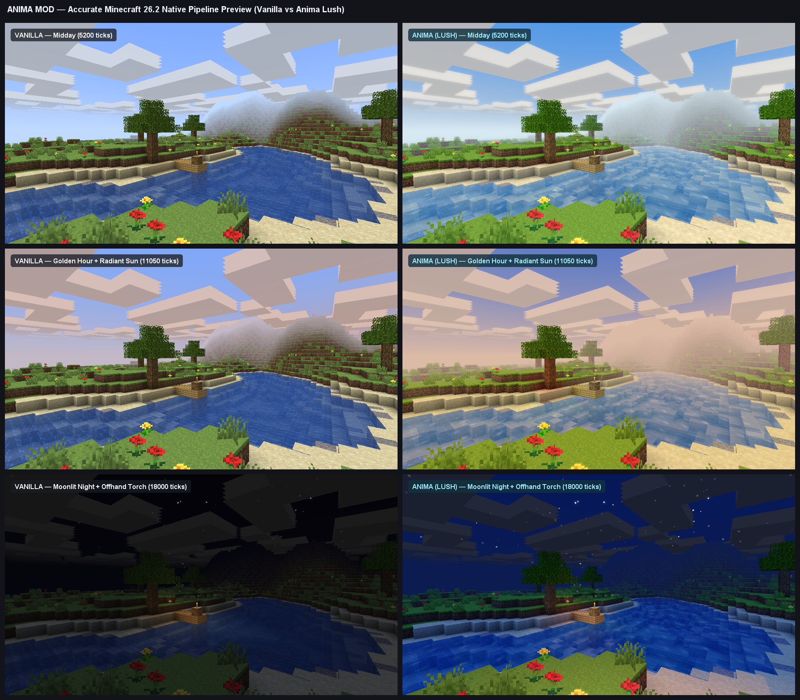
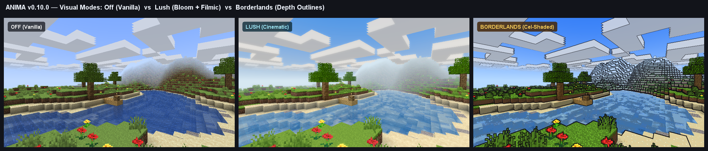
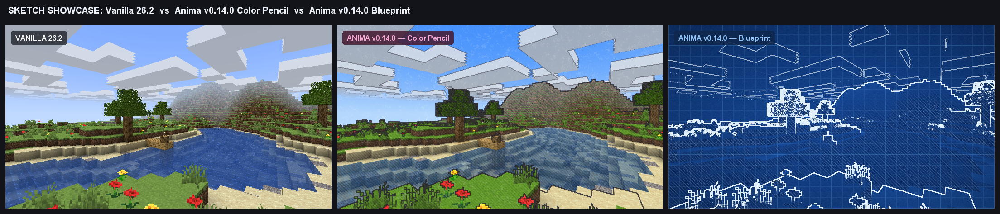
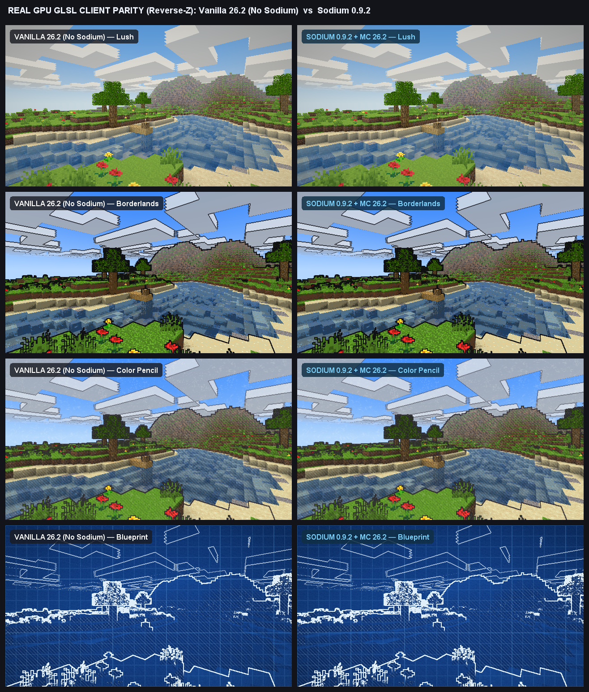

# Anima

**Shader-grade visuals for Minecraft 26.2 — delivered as a lightweight Fabric client mod with near-zero FPS cost.**

Anima replaces heavy deferred shader packs with native Minecraft 26.2 `PostChain` pipelines, custom terrain/water shaders, zero-lag GPU handheld dynamic lighting, and stylized visual modes — built to work seamlessly on **both Vanilla 26.2 and Sodium `0.9.x+mc26.2`** (OpenGL & Vulkan compatible).

---

## Visual Modes

Switch modes anytime from the **Escape Menu** via Anima's custom dark glassmorphic dropdown (or press `F9` to toggle):

| Mode | Description |
| :--- | :--- |
| **Lush** | Complementary-inspired atmosphere: 2-pass screen-space Bloom, ACES filmic grading, crystal turquoise animated wavy water, wind-swaying foliage, upgraded 32×32 pixel-art sun, luminous starlit nights, and zero-lag GPU handheld dynamic lighting. |
| **Borderlands** | Clean cel-shaded comic look with true Reverse-Z depth silhouette & cloud outlines (zero flat-ground grid), subtle texture-preserving cel shading, plus a full **Borderlands HUD** (chamfered diamond EXP badge, decorated nameplate, Armor/Health/Hunger+Saturation bars, underwater respiration bubbles, stylized hotbar, and unified bottom-right chat). |
| **Color Pencil** | Vibrant colored-pencil pigment on warm cream sketchbook paper tooth, subtle hand-drawn jitter, color-adaptive diagonal cross-hatching, and graphite silhouette outlines. |
| **Blueprint** | Textureless Prussian-blue architectural cyanotype with minor/major technical drafting grids, diagonal white shadow hatching, and crisp chalk-white silhouette linework. |
| **Off (Vanilla)** | Cleanly restores untouched Vanilla 26.2 rendering. |

---

## Gallery (Rendered via `Anima-renderer` on Real OpenGL 3.3 GPU)

### Vanilla 26.2 vs Anima Lush (Midday, Golden Hour & Moonlit Night + Offhand Torch)


### Borderlands Mode (Vanilla 26.2 vs Anima Borderlands vs Miasma R1.0.2)


### Sketch Modes (Vanilla 26.2 vs Color Pencil vs Blueprint)


### Real OpenGL 3.3 Client Parity (Vanilla 26.2 without Sodium vs Sodium 0.9.x)


---

## Key Features

- **Zero-Lag GPU Handheld Dynamic Lighting:** Holding torches, lanterns, glowstone, lava buckets, etc. in your main hand or offhand (plus dropped luminous items) smoothly illuminates nearby terrain per-frame on the GPU with zero chunk rebuilds.
- **Native Reverse-Z Depth Outlines:** Runs Anima's `PostChain` before `renderItemInHand` clears Minecraft 26.2's Reverse-Z depth buffer, producing razor-sharp outlines on terrain, grass, dead bushes, sugar cane, trees, mobs, and clouds with zero chessboard grid on flat ground or water.
- **Sodium & Vanilla Dual-Pack Architecture:** Automatically activates `anima:anima_shaders` for Vanilla/PostChain and conditionally registers `anima:anima_sodium_shaders` when Sodium is installed.
- **Custom Escape Menu Dropdown & Borderlands HUD:** Sleek dark dropdown selector in the pause menu + full Borderlands bottom-left status HUD, matching hotbar, and bottom-right chat panel when Borderlands mode is active.

---

## Installation

1. Install **Minecraft 26.2** with **Fabric Loader `>= 0.19.0`** and **Fabric API**.
2. Drop `anima-0.16.1.jar` from `Anima-mod/build/libs/` into your `.minecraft/mods/` folder.
3. *(Optional)* Works alongside **Sodium `0.9.x+mc26.2`**, **Lithium**, **ModMenu**, **ViaFabricPlus**, and **Iris** *(disable Iris shader packs while using Anima modes)*.

---

## Building from Source

### `Anima-mod` (Fabric 26.2)
```powershell
cd Anima-mod
gradle build --no-daemon
```
Output JAR: `Anima-mod/build/libs/anima-<version>.jar`

### `Anima-renderer` (Standalone OpenGL 3.3 GPU Validator & Showcase Renderer)
`Anima-renderer` loads real Minecraft 26.2 textures, validates both Vanilla (`terrain.vsh/.fsh`) and Sodium (`block_layer_opaque.vsh/.fsh`) GLSL shaders directly on OpenGL 3.3, and executes Anima's actual `PostChain` GLSL shaders against a Reverse-Z depth buffer:
```powershell
cd Anima-renderer
.\run.ps1
```

---

## Repository Structure

- `Anima-mod/` — Fabric 26.2 client mod (Java 25, Mixins, MixinExtras, GLSL shaders, custom UI/HUD).
- `Anima-renderer/` — Multi-threaded voxel + real LWJGL OpenGL 3.3 GPU shader validation and comparison renderer.
